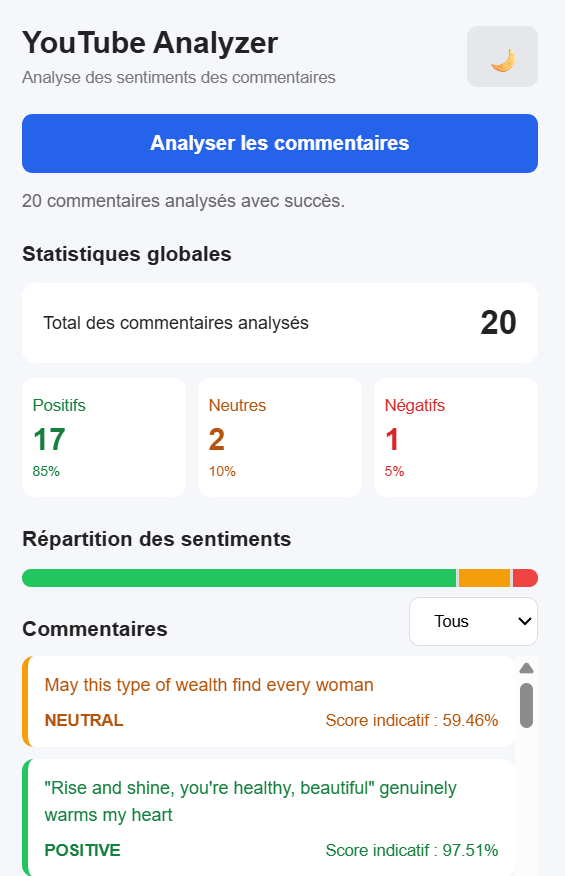
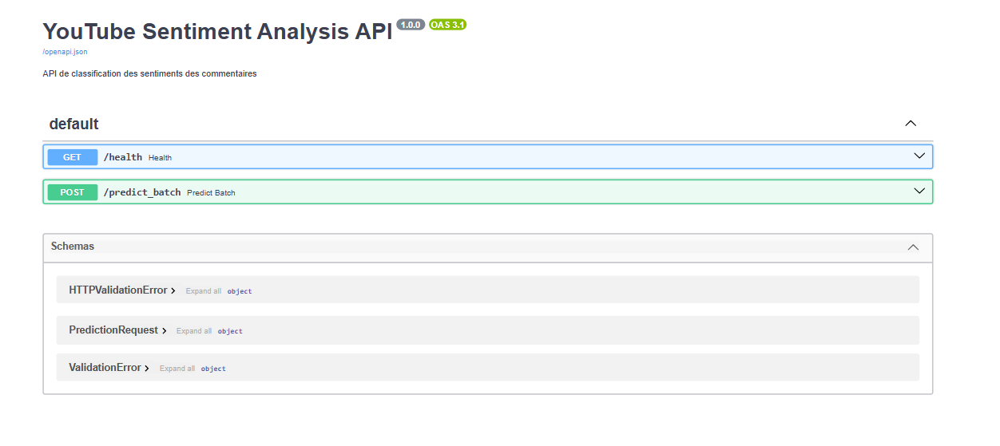

# Analyse de Sentiment des Commentaires YouTube

## Description du projet

Ce projet consiste à développer une application de Machine Learning permettant d'analyser automatiquement les sentiments exprimés dans les commentaires YouTube à l'aide du traitement automatique du langage naturel (NLP).

Le système classe les commentaires en trois catégories :

- **Positif (1)**
- **Neutre (0)**
- **Négatif (-1)**

Le projet comprend un modèle de Machine Learning entraîné, une API REST avec FastAPI et une extension Chrome permettant d'analyser directement les commentaires sur YouTube.

## Architecture du projet

```text
Analyse de Sentiment YouTube
│
├── Collecte et préparation des données
│
├── Entraînement du modèle
│   ├── Vectorisation TF-IDF
│   ├── Modèles de Machine Learning
│   └── Évaluation des modèles
│
├── API FastAPI
│   ├── Prédiction individuelle
│   ├── Prédiction par lot (Batch)
│   └── Vérification de disponibilité
│
├── Déploiement Docker
│   └── GitHub Codespaces
│
└── Extension Chrome
    ├── Extraction des commentaires
    ├── Communication avec l'API
    └── Affichage des sentiments
```

## Technologies utilisées

| Catégorie | Technologies |
|---|---|
| Langage de programmation | Python |
| Traitement des données | Pandas, NumPy |
| Machine Learning | Scikit-learn |
| NLP | TF-IDF |
| Modèles | Logistic Regression, Random Forest, LinearSVC |
| Sauvegarde des modèles | Joblib |
| Backend | FastAPI, Uvicorn |
| Documentation API | Swagger UI |
| Conteneurisation | Docker |
| Déploiement | GitHub Codespaces |
| Frontend | HTML, CSS, JavaScript |
| Extension navigateur | Chrome Extension Manifest V3 |

## Structure du projet

```text
youtube-sentiment-analysis/
│
├── data/
│   └── processed/
│       ├── cleaned_data.csv
│       ├── train.csv
│       └── test.csv
│
├── models/
│   ├── sentiment_model.joblib
│   ├── tfidf_vectorizer.joblib
│   └── confusion_matrix.png
│
├── src/
│   ├── data/
│   ├── models/
│   │   └── train_models.py
│   ├── api/
│   │   ├── main.py
│   │   └── schemas.py
│   └── utils/
│
├── chrome-extension/
│   ├── manifest.json
│   ├── content.js
│   ├── popup.html
│   ├── popup.css
│   └── popup.js
│
├── app_api.py
├── Dockerfile
├── requirements.txt
├── requirements-prod.txt
├── .dockerignore
└── README.md
```

## Installation

### 1. Cloner le dépôt GitHub

```bash
git clone https://github.com/hafsaelfekak/youtube-sentiment-analysis.git
cd youtube-sentiment-analysis
```

### 2. Créer un environnement virtuel

```bash
python -m venv venv
```

Activer l'environnement sous Windows :

```powershell
venv\Scripts\activate
```

### 3. Installer les dépendances

```bash
pip install -r requirements.txt
```

## Exécution locale de l'API

Pour démarrer l'API FastAPI, exécuter la commande suivante :

```bash
uvicorn app_api:app --reload
```

L'API sera accessible à l'adresse :

http://127.0.0.1:8000

La documentation interactive Swagger est disponible à l'adresse :

http://127.0.0.1:8000/docs

## Utilisation de l'API

L'API propose plusieurs endpoints permettant de vérifier son fonctionnement et d'analyser les commentaires.

| Endpoint | Méthode | Description |
|---|---|---|
| `/health` | GET | Vérifier la disponibilité de l'API |
| `/predict` | POST | Analyser un commentaire |
| `/predict_batch` | POST | Analyser plusieurs commentaires |
| `/docs` | GET | Accéder à la documentation interactive |

Les schémas des requêtes et les réponses peuvent être consultés et testés directement depuis Swagger UI (`/docs`).

## Déploiement de l'API avec Docker

L'API est déployée sur **GitHub Codespaces** à l'aide de Docker. Elle est accessible via une URL publique HTTPS.

### Configuration du déploiement

- **Conteneurisation :** Docker
- **Image de base :** `python:3.13-slim`
- **Dépendances de production :** `requirements-prod.txt`
- **Port exposé :** `7860`
- **Plateforme de déploiement :** GitHub Codespaces
- **Protocole :** HTTPS

### Construction de l'image Docker

L'image Docker contient uniquement les fichiers nécessaires à l'exécution de l'API :

- `app_api.py`
- `src/api/`
- `models/`
- `requirements-prod.txt`

Pour construire l'image Docker :

```bash
docker build -t youtube-sentiment-api .
```

Pour lancer le conteneur :

```bash
docker run -d -p 7860:7860 --name youtube-api youtube-sentiment-api
```

### URL publique de l'API

L'API déployée est accessible à l'adresse suivante :

**URL de base :**

https://urban-rotary-phone-97jjw5rjpxxvf6jv-7860.app.github.dev

### Accès aux endpoints

- **Documentation Swagger :** https://urban-rotary-phone-97jjw5rjpxxvf6jv-7860.app.github.dev/docs
- **Vérification de disponibilité :** https://urban-rotary-phone-97jjw5rjpxxvf6jv-7860.app.github.dev/health

L'endpoint `/predict_batch` peut également être testé depuis l'interface Swagger.

### Intégration avec l'extension Chrome

L'extension Chrome communique avec l'API déployée à travers son URL publique HTTPS.

L'URL de l'API est configurée dans le fichier `chrome-extension/popup.js`. Cela permet à l'extension d'envoyer les commentaires extraits de YouTube vers l'API pour effectuer leur analyse, sans avoir besoin de lancer un serveur local.

**Remarque :** l'URL publique dépend du Codespace et de la configuration du port. Elle peut changer si le Codespace ou le port est recréé.

## Installation de l'extension Chrome

1. Ouvrir Google Chrome.
2. Accéder à `chrome://extensions/`.
3. Activer le **Mode développeur**.
4. Cliquer sur **Charger l'extension non empaquetée**.
5. Sélectionner le dossier `chrome-extension`.
6. Ouvrir une vidéo YouTube contenant des commentaires.
7. Lancer l'extension pour analyser les commentaires.

## Évaluation du modèle

Plusieurs algorithmes de Machine Learning ont été étudiés et comparés :

- Logistic Regression
- Random Forest
- LinearSVC

L'évaluation repose sur les métriques suivantes :

- Accuracy (Exactitude)
- Precision (Précision)
- Recall (Rappel)
- F1-score
- Matrice de confusion

Le modèle sélectionné ainsi que le vectoriseur TF-IDF sont sauvegardés au format Joblib dans le dossier `models/`.

## Captures d'écran

Ajouter dans cette section les captures d'écran réelles de l'application :

### Extension Chrome



### Résultats de l'analyse des sentiments


### Documentation de l'API



## Limites du projet

- La qualité des prédictions dépend de la diversité et de la qualité des données d'entraînement.
- Le sarcasme et les expressions complexes peuvent être difficiles à classifier.
- L'extension analyse les commentaires actuellement chargés sur la page YouTube.
- La disponibilité de l'API dépend du fonctionnement du Codespace et de l'accessibilité du port public.

## Perspectives d'amélioration

- Améliorer la classification des sentiments avec des modèles NLP plus avancés.
- Ajouter la prise en charge de plusieurs langues.
- Améliorer l'extraction des commentaires et des réponses YouTube.
- Ajouter des statistiques et des visualisations des sentiments.
- Déployer l'API sur une plateforme cloud avec une disponibilité permanente.